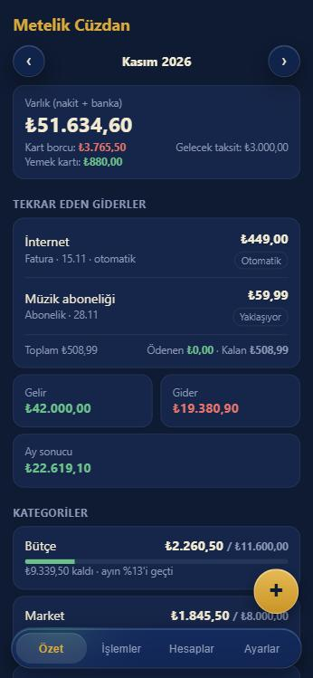
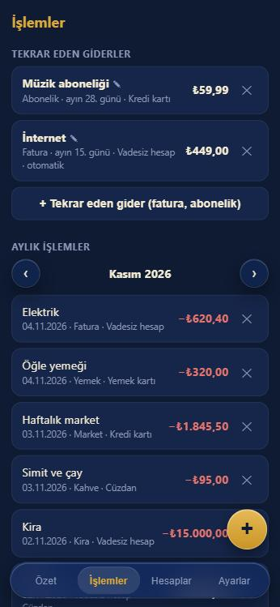
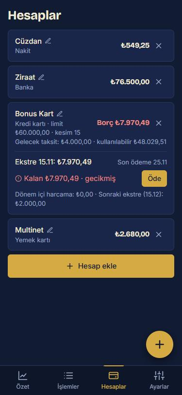
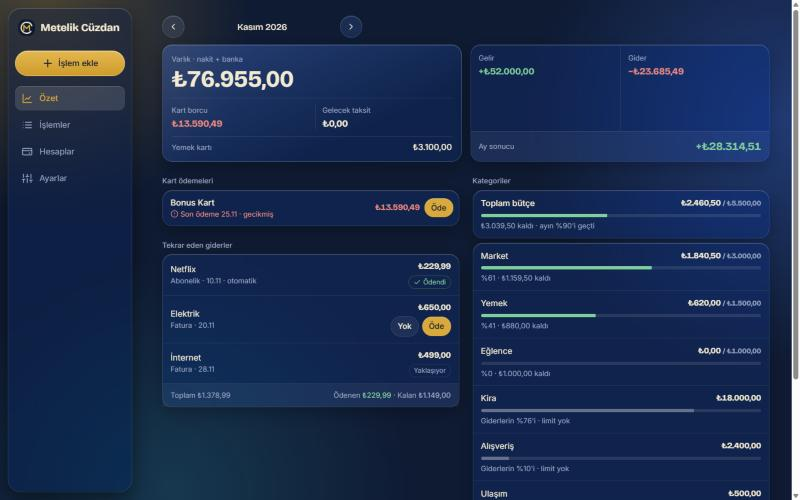

# Metelik Cüzdan

Telefonda ve bilgisayarda çalışan, kurulum istemeyen kişisel hesap takip uygulaması.
Gelir, gider, kredi kartı borcu, taksitler, abonelikler ve bütçe tek ekranda; veriler
yalnız senin cihazında kalır.

**Aç ve kullan:** https://siborgafro.github.io/metelik-cuzdan/

| Özet | İşlemler | Hesaplar |
|---|---|---|
|  |  |  |

Bilgisayarda geniş ekrana yayılır: solda menü, içerik iki sütun.

*Ekran görüntülerindeki tüm tutarlar örnektir.*

## Neler yapar

- **Hesaplar:** nakit, banka, kredi kartı, yemek kartı, kredi, kişi borç/alacak ve planlı ödeme. Açılış bakiyesi eksi olabilir.
- **Kredi:** aylık taksit, ödeme günü ve kalan taksit; kalan borç ve bu ayın taksiti görünür.
- **Borç / alacak:** kişi başına; + o kişinin sana borcu, − senin borcun. "Öde" ve "Tahsil et" kısayolları.
- **Planlı ödeme (borç):** Hesaplar'da ayrı tür; toplam borç ve isteğe bağlı son tarih. Parça parça ödenir, ilerleme çubuğu ve kalan tutar görünür; Özet'te listelenir.
- **Gelir, gider, transfer:** hesaplar arası para aktarımı dahil.
- **Kredi kartı:** limit, kesim günü ve son ödeme günü. Ekstre tutarını, dönem içi
  harcamayı, kullanılabilir limiti ve gecikmeyi gösterir; "Öde" kısayolu vardır.
- **Taksit:** kartla yapılan harcamayı aylara böler. Gelecek aylara düşen taksitler
  "gelecek taksit" olarak ayrıca görünür.
- **Tekrar eden giderler:** fatura ve abonelikler. Otomatik olanlar günü gelince
  kendiliğinden eklenir; diğerleri "ödeme bekleyen" listesine düşer.
- **Bütçe:** kategori başına aylık limit. %80'de ve aşımda uyarır.
- **Kendi kategorilerin:** gider ve gelir kategorilerini ekleyip silebilirsin.
- **Aylık özet:** varlık, kart borcu, gelir, gider ve ay sonucu.
- **Yedek:** tüm veriyi tek JSON dosyası olarak indirip geri yükleyebilirsin.
- **İsteğe bağlı şifreli senkron:** telefon ve bilgisayar arasında kendi özel GitHub
  reponu kullanarak eşitler. Veri cihazdan çıkmadan şifrelenir (PBKDF2 + AES-GCM);
  şifre hiçbir yerde saklanmaz.

## Kurulum

Uygulama mağazası yok; tarayıcıdan ana ekrana eklenir ve internetsiz de açılır.

- **iPhone:** Safari'de aç → Paylaş → **Ana Ekrana Ekle**.
- **Android:** Chrome'da aç → menü → **Uygulamayı yükle**.
- **Windows / Mac:** Chrome ya da Edge'de aç → adres çubuğundaki **Yükle** simgesi.

## Gizlilik

- Hesap açma, giriş ya da sunucu yok. Veriler tarayıcının kendi deposunda (IndexedDB)
  durur.
- Senkronu açmazsan hiçbir veri cihazından çıkmaz.
- Senkronu açarsan veri şifrelenmiş olarak yalnız senin seçtiğin özel GitHub reposuna
  gider.

## Teknik

Tek bir `index.html` dosyası: çerçeve ya da derleme adımı yok. Çevrimdışı çalışmak için
servis çalışanı (`sw.js`) kullanır ve GitHub Pages'te yayınlanır. Kod değiştiğinde
`sw.js` içindeki önbellek sürümü artırılır, böylece açık uygulamalar yeni sürümü alır.

Sürüm sürüm gelişim: [CHANGELOG.md](CHANGELOG.md) ve
[Releases](https://github.com/siborgafro/metelik-cuzdan/releases).

## English

Metelik Cüzdan is a personal finance tracker in Turkish that runs in the browser and
installs to the home screen as an app (PWA). It tracks accounts, credit card statements,
instalments, recurring bills and monthly budgets. Data stays on the device; optional
sync is end-to-end encrypted to a private GitHub repo of your own.

---

Bir Quenfro uygulaması.
